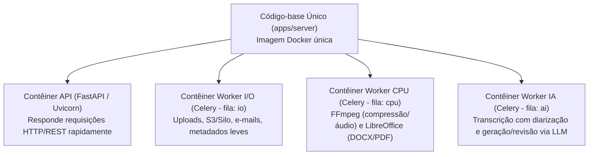

# DocFlow Server (`apps/server`)

Backend do **DocFlow** em **Python 3.12+**, estruturado como um **Monolito Modular** que reúne a **API HTTP (FastAPI)** e os **Workers assíncronos (Celery)** no mesmo código-base.

> **Documentação Técnica do Módulo (`apps/server/docs/`):**
> - [`docs/modelo-dominio.md`](./docs/modelo-dominio.md) — Glossário da linguagem ubíqua, invariantes de domínio e máquinas de estado (`Document`, `Media`, `Job`).
> - [`docs/diagrama-er.md`](./docs/diagrama-er.md) — Diagramas Entidade-Relacionamento (ER) detalhados por contexto.
> - [`docs/multi-tenancy.md`](./docs/multi-tenancy.md) — Estratégia de isolamento multi-tenant (`institution_id` + PostgreSQL RLS + prefixos no Silo/S3).
> - [`docs/upload-multipart.md`](./docs/upload-multipart.md) — Estratégia de upload multipart de até 10 GB / 2h30 direto no Silo via Cloudflare Tunnel.
> - [`docs/provedores-ia.md`](./docs/provedores-ia.md) — Interfaces `TranscriptionProvider` e `LLMProvider`, comparativo e plano de troca.

---

## 1. Por que Monolito Modular com API e Workers Juntos?

### Um único código-base, dividido por domínio (não microsserviços)
Em vez de separar o sistema em vários microsserviços (o que exigiria duplicar modelos de dados, autenticação e configurações de rede), todo o backend vive em `apps/server`, organizado em módulos independentes por contexto de negócio:

- `identity`: instituições (multi-tenant), usuários, autenticação e RBAC (`Administrador` e `Funcionário`)
- `media`: upload multipart no S3/Silo, extração de metadados (`ffprobe`) e compressão de vídeo (`ffmpeg`)
- `transcription`: pipeline de transcrição em português com diarização de falantes (`TranscriptionProvider`)
- `templates`: catálogo e versionamento de modelos de documentos institucionais
- `documents`: geração assistida por IA (`LLMProvider`), revisão automática, fluxo de validação e exportação (DOCX/PDF)
- `audit`: trilha de auditoria imutável (*append-only*)
- `shared`: configurações (`pydantic-settings`), conexão com banco (SQLAlchemy 2 + Alembic), Celery, segurança e utilitários transversais

### Camadas internas de cada módulo
Cada módulo segue uma divisão limpa de responsabilidades:
1. **`domain/`**: entidades, objetos de valor, interfaces (portas) e regras de negócio puras (testadas com TDD e sem depender de banco ou frameworks).
2. **`application/`**: casos de uso que orquestram o domínio, o banco e o disparo de jobs assíncronos.
3. **`infrastructure/`**: implementações concretas (repositórios SQLAlchemy, clientes S3/Silo, adaptadores de IA em nuvem, tasks do Celery).
4. **`api/`**: rotas FastAPI, schemas Pydantic de entrada/saída e dependências de autorização.

> **Regra de ouro:** um módulo não acessa diretamente as tabelas ou a infraestrutura interna de outro módulo, e `domain` nunca importa de `infrastructure` ou `api` (validado via `import-linter`).

---

## 2. Mesmo Código, Processos Separados em Execução

Embora a **API** e os **Workers** compartilhem o mesmo repositório, pacotes e modelos de domínio, eles **nunca disputam recursos no mesmo processo** em produção:



- **A API HTTP continua sempre leve e rápida:** quando o usuário pede para comprimir um vídeo, transcrever uma reunião ou gerar uma ata, a API apenas registra o `Job` no PostgreSQL, publica a tarefa no Redis e devolve a resposta imediatamente.
- **Os Workers fazem o trabalho pesado em segundo plano:** consomem as filas do Redis (`io`, `cpu`, `ai`), atualizam o progresso do `Job` no banco e salvam os resultados no Silo (S3) e no PostgreSQL, com limites de CPU/memória isolados no Docker Compose.

## 3. Estrutura inicial da API

```powershell
poetry install
poetry run docflow-api
```

Com `DOCFLOW_DEBUG=true`, a documentação interativa fica disponível em
`http://127.0.0.1:8000/docs`.

- Banco e migrações:
  - `poetry run alembic upgrade head`: aplica as migrações.
  - `poetry run alembic downgrade -1`: reverte a última migração.
  - `poetry run alembic revision --autogenerate -m "descricao"`: cria uma migração após alterar os modelos.

- `src/docflow/main.py`: criação da aplicação e entrypoint do Uvicorn.
- `src/docflow/api/router.py`: composição dos routers HTTP da aplicação.
- `src/docflow/api/routers/`: routers HTTP e seus schemas de entrada/saída.
- `src/docflow/application/`: casos de uso e orquestração.
- `src/docflow/domain/`: tipos e regras puras do domínio.
- `src/docflow/infra/`: integrações e implementações técnicas.
- `src/docflow/core/`: configuração e middleware compartilhados.

Os endpoints `/health` e `/ready` já estão registrados. O endpoint de readiness
retorna `503` até que PostgreSQL, Redis e Silo sejam integrados; isso evita
reportar uma aplicação operacional quando suas dependências ainda não existem.
Novos módulos de negócio devem seguir essas camadas somente quando houver
comportamento implementado, evitando pastas vazias e camadas artificiais.

Cada requisição HTTP também gera um log JSON com `request_id`, método, caminho,
status e duração. O nível pode ser configurado com `DOCFLOW_LOG_LEVEL`.
