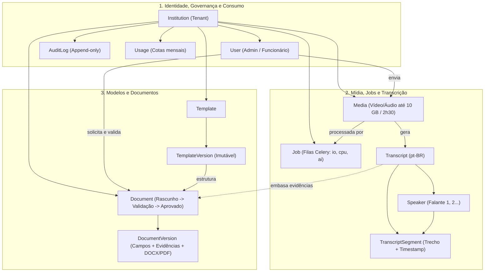
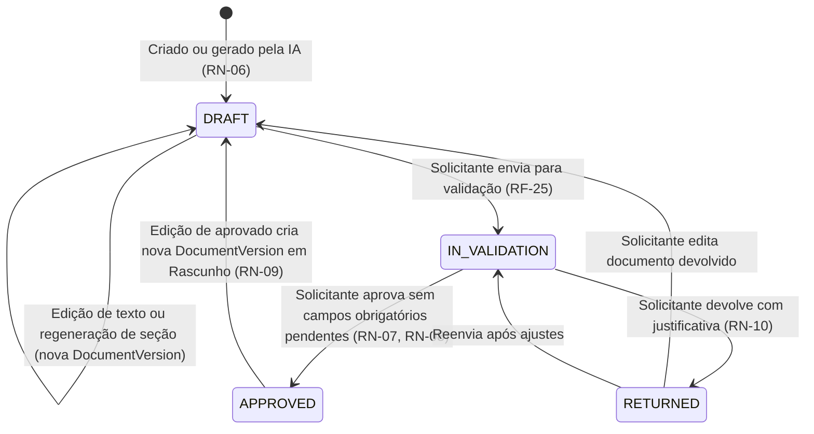
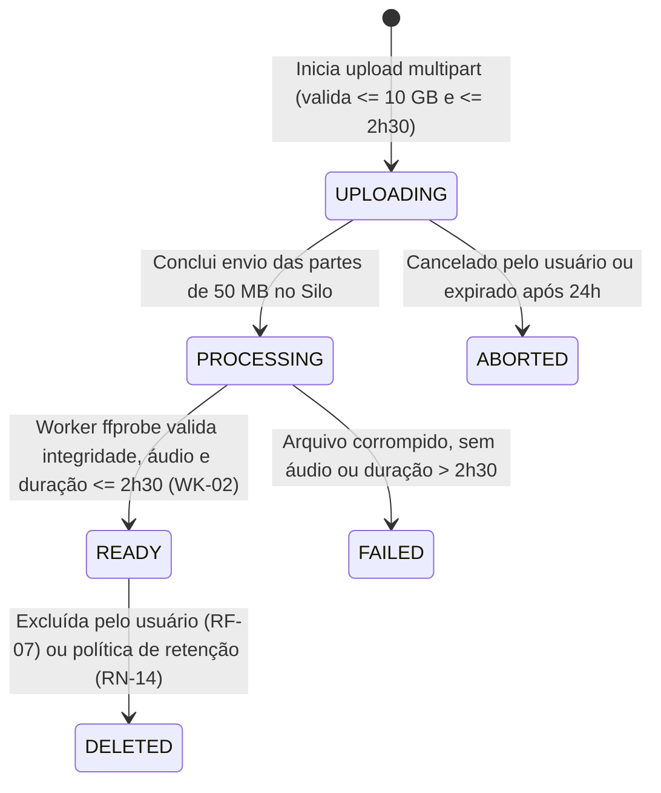
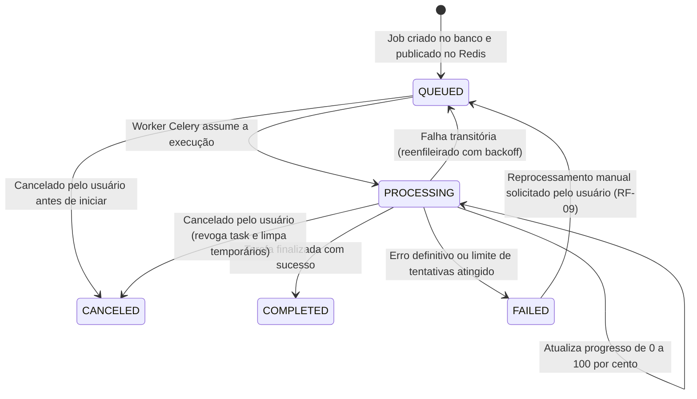

# Modelo de Domínio, Glossário e Diagrama ER (`apps/server/docs/modelo-dominio.md`)

Este documento define o modelo de domínio do **DocFlow**, incluindo o glossário da linguagem ubíqua, o Diagrama Entidade-Relacionamento (ER) das **13 entidades centrais**, os contratos de campos estruturados e as máquinas de estado de **`Document`**, **`Media`** e **`Job`**.

---

## 1. Glossário (Linguagem Ubíqua)

| Termo de Negócio | Entidade no Código | Definição no Domínio do DocFlow |
| :--- | :--- | :--- |
| **Instituição (Tenant)** | `Institution` | Escola, secretaria, órgão público ou ONG cadastrada na plataforma SaaS. Unidade raiz de isolamento de dados (`institution_id`, `RN-01`). |
| **Usuário** | `User` | Membro de uma instituição com perfil **`Administrador`** (`ADMIN`) ou **`Funcionário`** (`EMPLOYEE`). Pode estar `ACTIVE` (`Ativo`) ou `INACTIVE` (`Inativo`, `RN-04`). |
| **Mídia** | `Media` | Arquivo de vídeo ou áudio de uma reunião (até **10 GB** e **2h30** de duração, `RN-05`) armazenado no Silo (S3). Versões comprimidas geram um novo registro `Media` apontando para o arquivo original (`source_media_id`, `RN-18`). |
| **Job (Tarefa Assíncrona)** | `Job` | Execução em segundo plano processada pelos workers do Celery (`METADATA_EXTRACTION`, `VIDEO_COMPRESSION`, `TRANSCRIPTION`, `DOCUMENT_GENERATION`, `DOCUMENT_REVIEW`, `DOCUMENT_EXPORT`), com progresso (`0–100%`) e controle de falhas (`RF-09`). |
| **Transcrição** | `Transcript` | Resultado da conversão de uma `Media` em texto em português (`pt-BR`), contendo a lista de falantes e os trechos temporais (`RF-10`). |
| **Falante** | `Speaker` | Pessoa identificada na diarização da transcrição. Nasce com rótulo neutro (`"Falante 1"`, `"Falante 2"`, `RN-17`) e pode ser renomeada por um humano (ex.: `"Marina Carvalho"`), propagando o nome em todos os trechos (`RF-11`). |
| **Trecho de Transcrição** | `TranscriptSegment` | Segmento contínuo de fala dentro de uma `Transcript`, com tempo inicial (`start_ms`), tempo final (`end_ms`), falante (`speaker_id`), texto e índice de confiança (`0.0–1.0`, `RF-12`, `RF-14`). |
| **Modelo de Documento** | `Template` | Estrutura padronizada de documento administrativo (`ATA`, `OFICIO`, `MEMORANDO`, `PRESTACAO_CONTAS`). Pode ser um **modelo padrão do sistema** (`is_system_default = true`, `RF-16`) ou **exclusivo de uma instituição** (`RF-15`). |
| **Versão do Modelo** | `TemplateVersion` | Fotografia imutável de um `Template` publicado, contendo o arquivo base `.docx` e o esquema tipado de campos exigidos. Documentos gerados apontam sempre para uma `TemplateVersion` específica (`RN-12`). |
| **Documento** | `Document` | Documento administrativo gerado ou redigido na instituição. Nasce sempre como `DRAFT` (`Rascunho`, `RN-06`) e passa pelo fluxo de revisão e validação pelo próprio solicitante (`author_id`, `RN-07`). |
| **Versão do Documento** | `DocumentVersion` | Registro imutável de cada revisão do `Document`, guardando o conteúdo textual, os campos extraídos com suas **evidências** na transcrição (`RF-20`), o status de cada campo (`FILLED`, `PENDING`, `AMBIGUOUS`) e os arquivos exportados (`.docx`/`.pdf`). |
| **Evidência de Campo** | *(Valor em `DocumentVersion`)* | Vínculo entre um campo extraído pela IA e o(s) trecho(s) da transcrição (`transcript_segment_id`, `start_ms`, `end_ms`, citação) que comprovam a informação (`RF-20`, `RN-08`). |
| **Registro de Auditoria** | `AuditLog` | Evento imutável (*append-only*, `RN-11`) que registra quem fez o quê e quando na instituição (login, upload, geração, edição, aprovação, devolução, exportação, exclusão). |
| **Consumo / Cota** | `Usage` | Consolidação mensal do consumo da instituição (minutos de áudio transcritos, bytes armazenados no Silo e tokens de LLM consumidos) para controle de limites do plano (`RN-16`; compressão de vídeo é ilimitada e não consome cota, `RN-18`). |

---

## 2. Visão Geral dos Relacionamentos e Diagrama ER

Abaixo está o **mapa macro** de como as 13 entidades se conectam. Para visualizar todas as colunas, tipos e chaves de cada tabela em diagramas menores (divididos por contexto), acesse:

👉 **[Diagramas Entidade-Relacionamento Detalhados (`docs/diagrama-er.md`)](./diagrama-er.md)**



---

## 3. Estruturas JSONB Importantes (Campos e Evidências)

### 3.1. Esquema de Campos do Modelo (`TemplateVersion.fields_schema`)
Define quais informações a IA deve extrair da transcrição e quais são obrigatórias para permitir a aprovação (`RN-08`):

```json
[
  {
    "key": "data_reuniao",
    "label": "Data da Reunião",
    "type": "date",
    "required": true,
    "description": "Data em que a reunião ocorreu (DD/MM/AAAA)"
  },
  {
    "key": "participantes",
    "label": "Lista de Participantes",
    "type": "list",
    "required": true,
    "description": "Nomes e cargos dos presentes identificados na reunião"
  },
  {
    "key": "deliberacoes",
    "label": "Deliberações e Encaminhamentos",
    "type": "table",
    "required": true,
    "description": "Decisões tomadas, responsável e prazo acordado"
  }
]
```

### 3.2. Campos Extraídos com Evidência (`DocumentVersion.extracted_fields`)
Garante o cumprimento de `RF-19`, `RF-20` e `RN-08` (a IA nunca inventa valores; tudo que é preenchido aponta para o trecho da transcrição):

```json
{
  "data_reuniao": {
    "value": "2026-11-10",
    "status": "FILLED",
    "confidence": 0.98,
    "evidences": [
      {
        "transcript_id": "8f14e45f-ceea-467f-a8f1-...",
        "segment_id": "3c91a110-12b4-4e89-9a01-...",
        "start_ms": 12400,
        "end_ms": 18900,
        "quote": "Damos início à reunião ordinária do conselho hoje, dia 10 de novembro de 2026."
      }
    ]
  },
  "numero_processo_sei": {
    "value": null,
    "status": "PENDING",
    "confidence": 0.0,
    "evidences": [],
    "missing_reason": "O número do processo administrativo não foi mencionado na gravação."
  }
}
```
> **Regra de Domínio (`RN-08`):** Enquanto existir qualquer campo com `required == true` no `TemplateVersion` cujo `status` em `DocumentVersion.extracted_fields` seja `"PENDING"` ou `"AMBIGUOUS"`, a transição do `Document` para `APPROVED` é bloqueada pelo domínio.

---

## 4. Máquinas de Estado

### 4.1. Máquina de Estados de `Document` (`RF-24`, `RF-25`, `RN-06` a `RN-10`)



### 4.2. Máquina de Estados de `Media` (`RF-05` a `RF-08`, `RN-05`, `RN-14`)



### 4.3. Máquina de Estados de `Job` (`RF-09`, `RNF-04`, `WK-01`)


