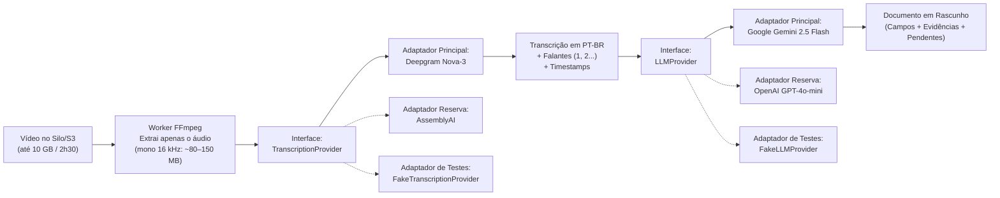

# Provedores de IA e Arquitetura de Interfaces (`apps/server/docs/provedores-ia.md`)

Este documento registra a pesquisa comparativa, a escolha dos provedores iniciais de Inteligência Artificial em nuvem para o MVP do **DocFlow** e o desenho das interfaces (`TranscriptionProvider` e `LLMProvider`) que evitam aprisionamento tecnológico (*vendor lock-in*).

---

## 1. Como a IA funciona no DocFlow (Visão Simples)

O DocFlow utiliza IA em nuvem em **duas etapas distintas**, isoladas por interfaces no código do backend (`apps/server`):



### Por que o limite de 10 GB do vídeo nunca estoura o limite do provedor de transcrição?
1. Em um vídeo de reunião de até **10 GB** e duração máxima de **2h30** (regra `RN-05`), cerca de **98% do tamanho é imagem**.
2. Antes de chamar a IA em nuvem, o worker executa o **FFmpeg** para extrair e normalizar **apenas o áudio** (mono, 16 kHz):
   - **2h30 de áudio comprimido (FLAC / MP3 / Opus 16 kHz mono):** pesa apenas **~70 MB a 135 MB**.
   - **2h30 de áudio sem compressão (WAV puro 16 kHz 16-bit mono):** pesa apenas **~275 MB**.
3. Ou seja: o vídeo bruto de 10 GB fica salvo apenas no nosso storage local (**Silo/S3**), e apenas o áudio leve (~100 MB) trafega pela internet até o provedor de transcrição.

---

## 2. Comparativo: Provedores de Transcrição (`TranscriptionProvider`)

Requisitos do MVP: suporte nativo a **Português do Brasil (`pt-BR`)**, **diarização de falantes** (*Speaker 1*, *Speaker 2*...), marcação de tempo (*timestamps* de início e fim) e nível de confiança por trecho.

| Critério | **Deepgram (Nova-3)** ⭐ *(Escolhido)* | **AssemblyAI (Universal-2)** *(Reserva)* | **Google Cloud STT V2 (Chirp 2)** | **OpenAI / Groq Whisper API** |
| :--- | :--- | :--- | :--- | :--- |
| **Qualidade em PT-BR + Diarização** | **Excelente.** Altíssima precisão em `pt-BR`, diarização nativa (`diarize=true`), pontuação inteligente (`smart_format`) e confiança por palavra/trecho. | **Excelente.** Ótima separação de falantes em reuniões com múltiplas vozes e ruído de fundo. | **Muito boa.** Boa precisão em `pt-BR` e suporte a diarização, porém exige configuração mais complexa no GCP. | Excelente transcrição em `pt-BR`, mas **não possui diarização nativa** na API oficial (exigiria rodar `pyannote` separado). |
| **Velocidade (2h30 de áudio)** | **~1 a 2 minutos** (um dos mais rápidos do mercado). | ~2 a 4 minutos. | ~3 a 6 minutos (batch). | ~2 a 5 minutos (exige fatiar o áudio). |
| **Preço médio / hora** | **~US\$ 0,32 / hora** (pré-gravado com diarização). | **~US\$ 0,37 / hora** | **~US\$ 0,96 / hora** | ~US\$ 0,04 a US\$ 0,36 / hora (sem falantes). |
| **Custo por reunião de 2h30** | **~US\$ 0,80** (~R\$ 4,50) | **~US\$ 0,92** (~R\$ 5,20) | **~US\$ 2,40** (~R\$ 13,50) | Descartado por falta de diarização. |
| **Limite de arquivo** | **Até 2 GB** por requisição (nosso áudio de 2h30 tem ~100 MB). | **Até 5 GB** (ou 10h de áudio). | Ilimitado via bucket GCS. | **25 MB a 100 MB** (obriga a quebrar o áudio em pedaços). |
| **DPA / LGPD e Retenção** | Possui DPA, conformidade SOC2/GDPR e opção de *opt-out* de uso de dados para treino. | Possui DPA, SOC2 Tipo 2; **não** treina modelos com dados da API por padrão; endpoint de deleção imediata. | Contrato LGPD nativo do Google Cloud; não treina com dados de clientes. | Não treina via API (retenção de 30 dias para auditoria). |
| **Região dos Dados** | EUA / União Europeia (`api.eu.deepgram.com`). | EUA / União Europeia (`api.eu.assemblyai.com`). | **Brasil (`southamerica-east1` - São Paulo)** ou EUA/UE. | EUA / União Europeia. |

---

## 3. Comparativo: Provedores de LLM para Documentos (`LLMProvider`)

Requisitos do MVP: ler a transcrição completa de uma reunião de até **2h30** (~25.000 a 35.000 palavras ≈ **40.000 tokens**), extrair os campos do modelo de documento (participantes, pauta, decisões, responsáveis, prazos) sem jamais inventar dados (`RN-08`), citar o trecho/timestamp de evidência (`RF-20`) e devolver um **JSON estritamente validado por Pydantic**.

| Critério | **Google Gemini 2.5 Flash** ⭐ *(Escolhido)* | **OpenAI (`gpt-4o-mini`)** *(Reserva)* | **Anthropic (`Claude 3.5 Haiku` / `Sonnet`)** |
| :--- | :--- | :--- | :--- |
| **Janela de Contexto** | **1.000.000 tokens** (cabe mais de 20 reuniões de 2h30 inteiras de uma só vez, sem precisar fatiar). | **128.000 tokens** (cabe 1 reunião de 2h30 inteira com folga). | **200.000 tokens** (cabe 1 reunião de 2h30 inteira). |
| **Saída Estruturada (Pydantic)** | **Nativa (`response_schema`).** Aceita classes Pydantic diretamente no SDK Python e garante JSON válido. | **Nativa (`Structured Outputs`).** Suporte direto a schemas Pydantic (`client.beta.chat.completions.parse`). | Via *Tool Use* / JSON mode (muito boa, mas exige validação extra). |
| **Custo médio por reunião de 2h30 (~40k tokens entrada + ~4k saída)** | **~US\$ 0,02 a US\$ 0,04** (menos de **R\$ 0,25** por documento gerado!). Possui *free tier* para desenvolvimento. | **~US\$ 0,02 a US\$ 0,05** (~R\$ 0,25 por documento gerado). | **~US\$ 0,08 (Haiku) a US\$ 0,30 (Sonnet)**. |
| **Retenção de Dados e Privacidade (LGPD)** | Na modalidade paga (API Pay-as-you-go / Vertex AI), os dados **não são usados** para treinar modelos do Google. | Dados enviados via API **não são usados** para treinar modelos por padrão (retenção de 30 dias para segurança, ou *Zero Data Retention* sob contrato). | Dados da API **não são usados** para treino por padrão. |
| **Região dos Dados** | Global / EUA / **São Paulo (`southamerica-east1` via Vertex AI)**. | EUA / União Europeia. | EUA / União Europeia (ou via Vertex/Bedrock). |

---

## 4. Decisão Inicial para o MVP

1. **Transcrição com Diarização (`TranscriptionProvider`):**
   - **Provedor Principal:** **Deepgram (`nova-3`, idioma `pt-BR`, `diarize=true`, `smart_format=true`)**.
   - **Provedor Reserva (Plano B):** **AssemblyAI (`universal-2`, `language_code="pt"`, `speaker_labels=True`)**.
   - *(Caso uma instituição pública exija contratualmente que o áudio não saia do território brasileiro, basta ativar o adaptador do **Google Cloud Speech-to-Text V2** apontando para a região `southamerica-east1` em São Paulo).*

2. **Geração e Revisão de Documentos (`LLMProvider`):**
   - **Provedor Principal:** **Google Gemini 2.5 Flash** (via SDK oficial `google-genai` com `response_schema` Pydantic).
   - **Provedor Reserva (Plano B):** **OpenAI `gpt-4o-mini`** (com `Structured Outputs`).

3. **Desenvolvimento Local e Testes Automatizados (CI):**
   - **`FakeTranscriptionProvider` e `FakeLLMProvider`:** implementações locais determinísticas e instantâneas que devolvem transcrições e documentos de exemplo sem gastar créditos e sem precisar de internet para rodar a suíte de testes (`pytest` e `Playwright`).

---

## 5. Desenho das Interfaces e Plano de Troca

O domínio e os casos de uso do DocFlow conhecem **apenas os protocolos internos** (nunca importam SDKs da Deepgram, Google ou OpenAI diretamente):

```python
from typing import Protocol, TypeVar
from pydantic import BaseModel

T = TypeVar("T", bound=BaseModel)

class TranscriptionProvider(Protocol):
    async def transcribe(
        self,
        audio_path: str,
        *,
        language: str = "pt-BR",
        expected_speakers: int | None = None,
    ) -> TranscriptionResult: ...


class LLMProvider(Protocol):
    async def generate_structured(
        self,
        *,
        system_prompt: str,
        user_content: str,
        response_model: type[T],
        temperature: float = 0.1,
    ) -> T: ...
```

### Como funciona o Plano de Troca (em menos de 5 minutos)
A seleção de qual adaptador concreto será injetado nos workers é controlada exclusivamente por **variáveis de ambiente no Infisical**, sem necessidade de alterar regras de negócio:

- `TRANSCRIPTION_PROVIDER=deepgram` *(valores suportados: `deepgram`, `assemblyai`, `google_stt`, `fake`)*
- `LLM_PROVIDER=gemini` *(valores suportados: `gemini`, `openai`, `fake`)*

Se um provedor sofrer instabilidade, aumentar preços ou deixar de atender requisitos contratuais de uma instituição:
1. Altera-se a variável correspondente no **Infisical** (e a chave de API do novo provedor).
2. Reiniciam-se os contêineres `worker-ai` sem necessidade de reescrever casos de uso, banco de dados ou telas do frontend.
