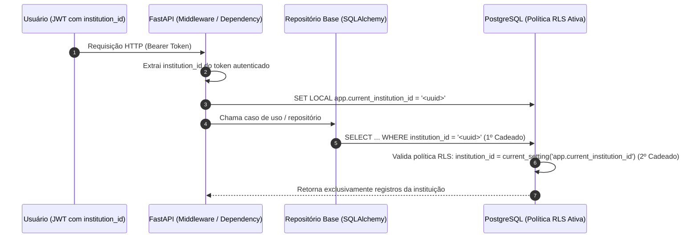

# Estratégia de Multi-tenancy e Isolamento de Dados (`apps/server/multi-tenancy.md`)

Este documento descreve como o **DocFlow** garante o isolamento estrito dos dados entre diferentes instituições (regra de negócio `RN-01` e requisito `RNF-06`) no banco de dados PostgreSQL, nos workers do Celery e no Object Storage (Silo/S3).

---

## 1. Decisão Arquitetural: Coluna `institution_id` + PostgreSQL RLS (Defesa em Profundidade)

Adotamos o modelo de **banco de dados e tabelas compartilhadas com coluna discriminadora (`institution_id`) combinada com Row-Level Security (RLS) nativo do PostgreSQL**.

### Por que escolhemos esta abordagem?

| Alternativa | Veredito | Motivo |
| :--- | :--- | :--- |
| **Schema ou Banco separado por instituição** | Descartado | Complexidade operacional alta em servidor on-premise: cada migração do Alembic precisaria rodar N vezes (uma para cada instituição) e o consumo de conexões/memória cresceria linearmente. |
| **Apenas coluna `institution_id` filtrada no Python** | Insuficiente sozinho | Embora simples, depende 100% de nenhum desenvolvedor esquecer um `.where(Model.institution_id == current_tenant)` em uma query futura. |
| **Coluna `institution_id` no Repositório Base + RLS no PostgreSQL** ⭐ | **Adotado** | Combina a simplicidade de um único schema (migrações instantâneas no Alembic) com um **cadeado duplo**: filtro explícito no Python + bloqueio automático no próprio motor do PostgreSQL. |

---

## 2. Como funciona o "Cadeado Duplo" na Prática



### 1º Cadeado: Repositório Base na Aplicação (`apps/server`)
- Toda tabela de negócio (`users`, `media`, `transcripts`, `templates`, `documents`, `audit_logs`, `jobs`, `usage`) possui a coluna obrigatória:
  ```sql
  institution_id UUID NOT NULL REFERENCES institutions(id)
  ```
- O `TenantRepository` base do SQLAlchemy recebe obrigatoriamente o `institution_id` do contexto autenticado e adiciona o filtro `WHERE institution_id = :institution_id` em todas as leituras, atualizações e exclusões.

### 2º Cadeado: Row-Level Security (RLS) no PostgreSQL
- Nas migrações do Alembic, todas as tabelas multi-tenant têm o RLS habilitado e forçado:
  ```sql
  ALTER TABLE documents ENABLE ROW LEVEL SECURITY;
  ALTER TABLE documents FORCE ROW LEVEL SECURITY;

  CREATE POLICY tenant_isolation_policy ON documents
    USING (institution_id = current_setting('app.current_institution_id', true)::uuid)
    WITH CHECK (institution_id = current_setting('app.current_institution_id', true)::uuid);
  ```
- No início de cada transação da API (ou de cada task do Celery), a sessão do SQLAlchemy executa:
  ```sql
  SET LOCAL app.current_institution_id = '<institution_id>';
  ```
- **Resultado:** mesmo que uma query seja escrita sem `WHERE institution_id = ...`, o PostgreSQL **não retorna nem altera** nenhuma linha pertencente a outra instituição.

> **Exceção controlada ( Modelos Padrão do Sistema — `RF-16` ):**
> Na tabela `templates`, modelos padrão do sistema (`is_system_default = true`, `institution_id IS NULL`) permitem leitura (`SELECT`) por qualquer instituição autenticada, mas escrita/edição continua restrita ao próprio tenant.

---

## 3. Isolamento nos Workers do Celery

Quando a API enfileira uma tarefa assíncrona no Redis (ex.: transcrever mídia ou gerar ata):
1. O registro na tabela `jobs` já nasce vinculado ao `institution_id`.
2. O payload da task do Celery carrega obrigatoriamente `institution_id` e `job_id`.
3. Ao iniciar a execução da task, o worker abre a transação no banco configurando `SET LOCAL app.current_institution_id = '<institution_id>'`, garantindo exatamente o mesmo isolamento da API HTTP.

---

## 4. Isolamento no Object Storage (Silo / S3)

No **Silo** (nosso Object Storage S3-compatível), os arquivos nunca ficam misturados na raiz dos buckets (`media-raw`, `media-processed`, `documents`):

- **Padronização de Chaves (Object Keys) por Prefixo de Tenant:**
  ```text
  media-raw/<institution_id>/<media_id>/<filename>
  media-processed/<institution_id>/<media_id>/audio-16k.flac
  documents/<institution_id>/<document_id>/v1/ata.pdf
  ```
- **Acesso Exclusivo via URLs Pré-assinadas Temporárias (`RNF-05`):**
  O navegador nunca tem acesso aberto a um bucket. Antes de gerar uma *Presigned URL* (para upload multipart ou para download/visualização), a API valida no PostgreSQL se o usuário autenticado pertence ao `institution_id` dono daquele `media_id` ou `document_id`.

---

## 5. Testes Obrigatórios de Isolamento (`BE-03`)

Na suíte de testes automatizados (`pytest`), todo módulo de domínio/infraestrutura deve incluir testes verificando que:
1. Um usuário da **Instituição A** tentando buscar, editar ou excluir um recurso pelo ID da **Instituição B** recebe `404 Not Found` (sem vazar sequer a existência do registro).
2. Uma consulta executada na sessão da **Instituição A** nunca lista registros da **Instituição B**, mesmo sem filtro explícito na query SQL (validando o funcionamento da política RLS).
