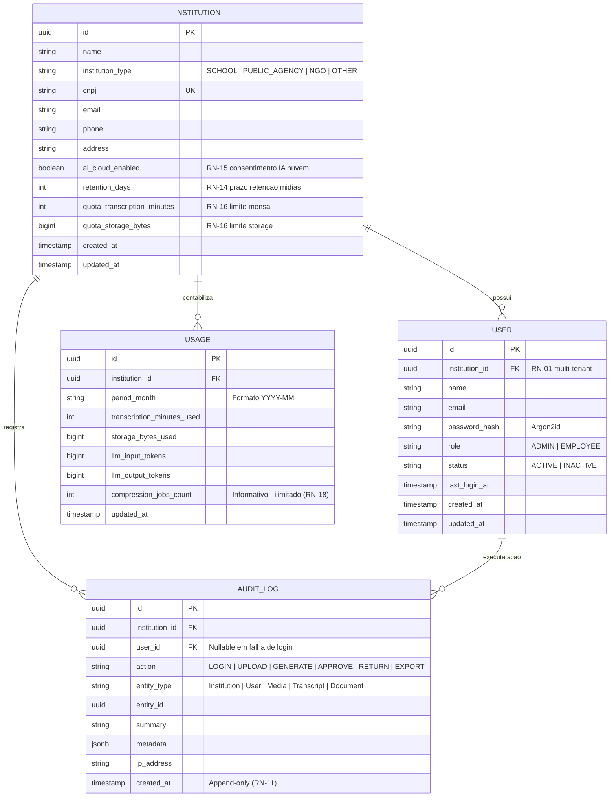
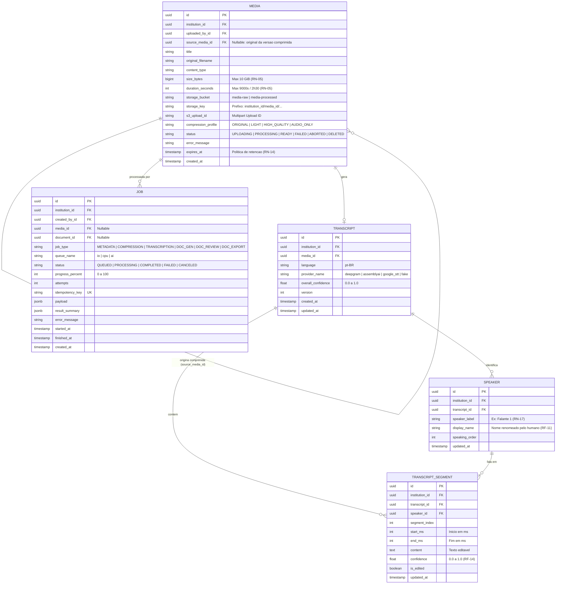
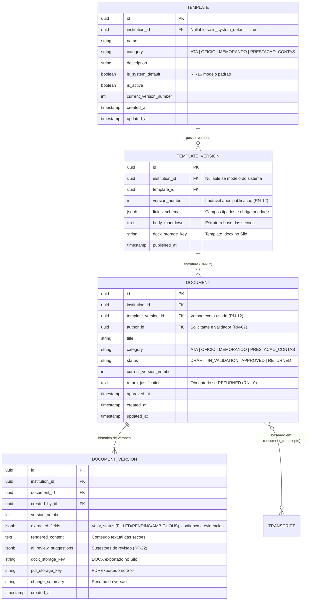

# Diagramas Entidade-Relacionamento Detalhados (`docs/diagrama-er.md`)

Para facilitar a leitura direta no GitHub sem precisar de *zoom* ou navegação por setas, o Diagrama Entidade-Relacionamento (ER) completo do **DocFlow** está dividido abaixo nos **3 contextos de domínio** do sistema.

> Voltar para: [`docs/modelo-dominio.md`](./modelo-dominio.md)

---

## 1. Contexto de Identidade, Auditoria e Consumo (`identity`, `audit`)

Reúne a instituição (tenant raiz), seus usuários (`ADMIN` / `EMPLOYEE`), a trilha imutável de auditoria e a contabilização mensal de cotas.

---

## 2. Contexto de Mídia, Jobs e Transcrição (`media`, `transcription`)

Reúne o upload multipart de vídeos/áudios (até 10 GB e 2h30), a fila de jobs assíncronos do Celery e a transcrição com diarização de falantes em português (`pt-BR`).

---

## 3. Contexto de Modelos e Documentos (`templates`, `documents`)

Reúne o catálogo versionado de modelos (`Template` e `TemplateVersion`) e os documentos gerados pela IA, suas versões imutáveis com evidências e arquivos exportados (`.docx`/`.pdf`).

