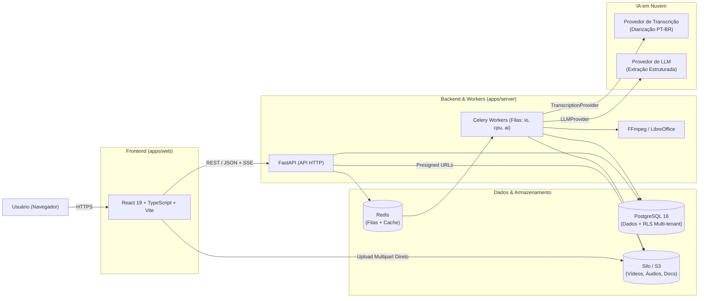

# Stack Tecnológica do DocFlow

Este documento descreve, de forma direta e prática, as tecnologias escolhidas para construir e operar o **DocFlow**, explicando o papel de cada ferramenta dentro da plataforma.

---

## 1. Visão Geral em uma Imagem

---

## 2. Frontend (`apps/web`)

Focado em uma interface rápida, acessível (WCAG 2.1 AA) e totalmente tipada em português (`pt-BR`).

| Tecnologia | Papel no Projeto | Por que escolhemos? |
| :--- | :--- | :--- |
| **React 19 + TypeScript 5.7** | Construção da interface de usuário | Ecossistema maduro, tipagem estática forte de ponta a ponta e facilidade para criar editores ricos (transcrição sincronizada com vídeo e revisão de documentos). |
| **Vite 8** | Bundler e servidor de desenvolvimento | Inicialização instantânea, Hot Module Replacement (HMR) rápido e build enxuta para produção. |
| **Tailwind CSS v4** | Estilização e Design System | Produtividade na criação de layouts responsivos e consistência visual sem CSS inchado. |
| **React Router** | Roteamento SPA | Controle de rotas públicas e protegidas por perfil (`Administrador` e `Funcionário`). |
| **TanStack Query** | Estado assíncrono e cache HTTP | Sincronização de dados com a API, invalidação automática de cache e acompanhamento de jobs. |
| **OpenAPI TypeScript / Orval** | Cliente HTTP tipado | Gera automaticamente os tipos e chamadas da API a partir do `contracts/openapi.json` exportado pelo backend, evitando divergências entre front e back. |
| **Vitest + Testing Library + Playwright** | Testes de unidade, componentes e E2E | Garante que fluxos críticos (upload, transcrição, geração e aprovação) funcionem sem regressões. |

---

## 3. Backend e Workers (`apps/server`)

Adotamos um **monolito modular** em Python: a API HTTP e os workers assíncronos compartilham a mesma base de código e regras de negócio, mas rodam em processos/contêineres independentes.

| Tecnologia | Papel no Projeto | Por que escolhemos? |
| :--- | :--- | :--- |
| **Python 3.12+ & `uv`** | Linguagem base e gerenciador de pacotes | Linguagem padrão do ecossistema de IA/mídia; o `uv` garante resolução e instalação de dependências ultrarrápidas e reprodutíveis. |
| **FastAPI + Pydantic v2** | API HTTP e validação de esquemas | Alta performance assíncrona, validação rigorosa de dados (incluindo saídas estruturadas da IA) e geração nativa do contrato OpenAPI (`contracts/openapi.json`). |
| **SQLAlchemy 2 + Alembic** | ORM e migrações de banco de dados | Mapeamento moderno com tipagem estática e histórico versionado de alterações no esquema do banco. |
| **Celery** | Processamento assíncrono em background | Executa tarefas pesadas fora do ciclo de requisição da API, separadas em três filas: `io` (storage/metadados), `cpu` (FFmpeg/conversões) e `ai` (transcrição e LLMs). |
| **FFmpeg / `ffprobe`** | Processamento de vídeo e áudio | Valida integridade e duração (≤ 2h30), comprime vídeos e extrai áudio normalizado (mono, 16 kHz) sem carregar arquivos de 10 GB na memória. |
| **LibreOffice Headless + `python-docx`** | Geração e exportação de documentos | Preenche modelos `.docx` padronizados da instituição e converte para `.pdf` mantendo a formatação oficial. |
| **Pytest + Hypothesis + Ruff + Mypy** | Testes (TDD), lint e checagem de tipos | Mantém o domínio testado, seguro e livre de acoplamento indevido entre camadas (`import-linter`). |

---

## 4. Banco de Dados, Filas e Armazenamento

| Tecnologia | Papel no Projeto | Por que escolhemos? |
| :--- | :--- | :--- |
| **PostgreSQL** | Banco de dados relacional principal | Robusto e confiável; suporta **Row-Level Security (RLS)** para isolamento multi-tenant por `institution_id`, busca textual nativa (`tsvector`) e permissões *append-only* para a trilha de auditoria. |
| **Redis** | Broker de mensagens e controle de taxa | Gerencia as filas de tarefas do Celery com persistência (AOF), controla *rate limiting* de autenticação e auxilia no acompanhamento de progresso de jobs. |
| **Silo (fork do MinIO, S3-compatível)** | Object Storage self-hosted | Alternativa aberta e gratuita ao MinIO com total compatibilidade S3. Armazena arquivos grandes (vídeos de até 10 GB, áudios processados e documentos exportados) em buckets separados (`media-raw`, `media-processed`, `documents`) e permite **upload multipart direto do navegador** via URLs pré-assinadas, sem sobrecarregar a API. |

---

## 5. Inteligência Artificial (Nuvem atrás de Interfaces)

No MVP, tanto a transcrição quanto a geração de documentos utilizam **provedores em nuvem**, mas o código de negócio nunca chama um SDK externo diretamente:

- **`TranscriptionProvider` (Interface):** encapsula o serviço de Speech-to-Text com **diarização de falantes** e *timestamps* em português (`pt-BR`).
- **`LLMProvider` (Interface):** encapsula o modelo de linguagem responsável por extrair campos do documento (participantes, pauta, decisões, prazos) com **evidências vinculadas à transcrição** e validação via Pydantic, bem como a revisão automática do texto.

> **Vantagem prática:** podemos trocar de provedor de IA (por custo, qualidade ou exigência de LGPD) ou usar *fakes* determinísticos nos testes automatizados alterando apenas o adaptador de infraestrutura.

---

## 6. Infraestrutura, Segurança e Operação (`infra/`)

Toda a aplicação roda em **servidor próprio (on-premise)** utilizando contêineres padronizados.

| Tecnologia | Papel no Projeto | Por que escolhemos? |
| :--- | :--- | :--- |
| **Docker & Docker Compose** | Empacotamento e orquestração | Padroniza a execução local (`dev`) e no servidor (`staging` e `prod`), isolando redes e limites de CPU/memória de cada serviço. |
| **Terraform + HCP Terraform** | Infraestrutura como Código (IaC) | Versiona a configuração de rede, containers, buckets do Silo (S3) e DNS, mantendo o estado (`.tfstate`) seguro na nuvem e aplicando mudanças no servidor local via **HCP Terraform Agent**. |
| **Infisical** | Gestão centralizada de segredos | Injeta variáveis de ambiente e chaves de API em tempo de execução (`infisical run`). **Nenhum segredo ou `.env` real fica salvo no repositório Git.** |
| **GitHub Actions** | Integração e Entrega Contínua (CI/CD) | Executa testes, linters, validação de contrato OpenAPI e `terraform plan` a cada Pull Request, além de publicar imagens e automatizar o deploy. |
