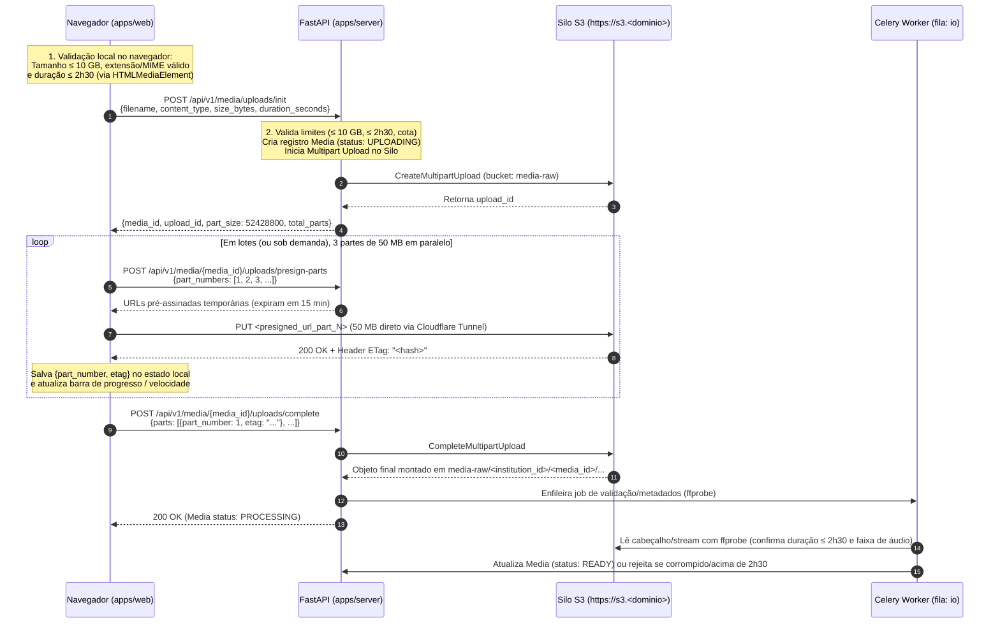

# Estratégia de Upload de 10 GB via Multipart no Silo/S3 (`docs/upload-multipart.md`)

Este documento define a arquitetura e as regras técnicas para o envio de arquivos de vídeo e áudio de até **10 GB** e duração máxima de **2h30** (`RF-05`, `RF-06`, `RN-05`, `RNF-03`), operando em conjunto com o **Silo (fork do MinIO)** e o **Cloudflare Tunnel**.

---

## 1. Por que Upload Multipart Direto para o Silo?

Enviar um arquivo de até **10 GB** exige três cuidados fundamentais na nossa arquitetura:

1. **Proteger a Memória e CPU da API (`apps/server`):**
   - O arquivo de mídia **nunca passa por dentro do servidor FastAPI**. A API trafega apenas metadados leves (JSON) e assina URLs temporárias (*Presigned URLs*). Os bytes do vídeo vão direto do navegador do usuário para o **Silo (`https://s3.<dominio>`)**.
2. **Respeitar o Limite de 100 MB por Requisição do Cloudflare Tunnel:**
   - No plano gratuito da Cloudflare, qualquer requisição HTTP única acima de **100 MB** é bloqueada na borda com erro `413 Payload Too Large`.
   - Ao fatiar o arquivo no navegador em **partes de 50 MB**, cada parte é enviada em uma requisição `PUT` independente de 50 MB, passando com folga pelo Cloudflare Tunnel.
3. **Suportar Retomada em Caso de Queda de Rede:**
   - Se a conexão do usuário cair na parte 150 de 200, apenas a parte em andamento precisa ser reenviada; as 149 partes anteriores já estão salvas no Silo.

---

## 2. Parâmetros Técnicos Adotados

| Parâmetro | Valor Definido | Justificativa |
| :--- | :--- | :--- |
| **Tamanho máximo do arquivo** | **10 GB** (`10 * 1024 * 1024 * 1024` bytes) | Requisito `RF-05` / `RN-05`. |
| **Duração máxima da mídia** | **2h30 (150 minutos / 9.000 segundos)** | Requisito `RN-05`. |
| **Formatos permitidos** | Vídeo: `mp4`, `mkv`, `mov`, `webm`<br>Áudio: `mp3`, `wav`, `m4a`, `flac`, `ogg` | Requisito `RF-06`. |
| **Tamanho de cada parte (*Chunk Size*)** | **50 MB** (`52.428.800` bytes) | Metade do limite de 100 MB por requisição do Cloudflare Tunnel Free; gera no máximo **205 partes** para um vídeo de 10 GB (bem abaixo do limite de 10.000 partes da especificação S3). |
| **Paralelismo no navegador** | **3 partes simultâneas** | Maximiza o uso da banda de upload do usuário sem travar a aba do navegador nem saturar conexões domésticas. |
| **Retentativas por parte** | Até **3 tentativas automáticas** com *backoff* exponencial (`1s`, `3s`, `9s`) + retomada manual | Garante resiliência contra oscilações rápidas de Wi-Fi/internet. |
| **Expiração de uploads abandonados** | **24 horas** | Regra de ciclo de vida (*Lifecycle Rule* `AbortIncompleteMultipartUpload`) no bucket `media-raw` do Silo + job diário do Celery Beat para limpar registros órfãos no banco. |

---

## 3. Fluxo Completo Passo a Passo



---

## 4. Regras de Segurança, CORS e Validação Dupla

### 4.1. Validação Dupla (Antes e Depois do Upload)
1. **Antes de iniciar (`init`):**
   - O **Frontend (`apps/web`)** inspeciona `file.size` (`≤ 10 GB`), extensão/MIME type e carrega os metadados locais do arquivo em um elemento de mídia temporário (`URL.createObjectURL(file)`) para ler a duração (`≤ 2h30`). Se violar, bloqueia imediatamente na tela com mensagem clara (`RN-05`).
   - A **API (`apps/server`)** revalida `size_bytes ≤ 10 GiB`, `duration_seconds ≤ 9000` e tipo permitido antes de chamar o Silo.
2. **Após concluir (`complete`):**
   - Como dados vindos do cliente nunca são 100% confiáveis, o worker (`WK-02`) executa o `ffprobe` sobre o arquivo no Silo para confirmar integridade, presença de faixa de áudio e duração real `≤ 2h30`. Caso o arquivo real exceda 2h30 ou esteja corrompido, o objeto é removido do Silo e a mídia recebe status de erro com justificativa clara.

### 4.2. Configuração Obrigatória de CORS no Silo (`INF-06`)
Para que o navegador consiga enviar as partes de 50 MB diretamente para `https://s3.<dominio>` e ler o cabeçalho `ETag` devolvido pelo Silo em cada parte (necessário para o `CompleteMultipartUpload`), o bucket `media-raw` deve ter a seguinte política de CORS:

```json
{
  "CORSRules": [
    {
      "AllowedOrigins": ["https://app.<dominio>", "http://localhost:8443"],
      "AllowedMethods": ["PUT", "GET", "HEAD"],
      "AllowedHeaders": ["*"],
      "ExposeHeaders": ["ETag", "x-amz-request-id"],
      "MaxAgeSeconds": 3600
    }
  ]
}
```

### 4.3. Cancelamento e Limpeza (`abort`)
- Se o usuário clicar em **"Cancelar upload"**, o frontend chama `POST /api/v1/media/{media_id}/uploads/abort`, que executa `AbortMultipartUpload` no Silo (liberando imediatamente o espaço em disco das partes já enviadas) e marca o registro como cancelado.
- Caso o usuário feche o navegador e não retome o envio em **24 horas**, a regra de ciclo de vida do Silo e a tarefa agendada do Celery (`WK-11`) descartam automaticamente as partes incompletas.
