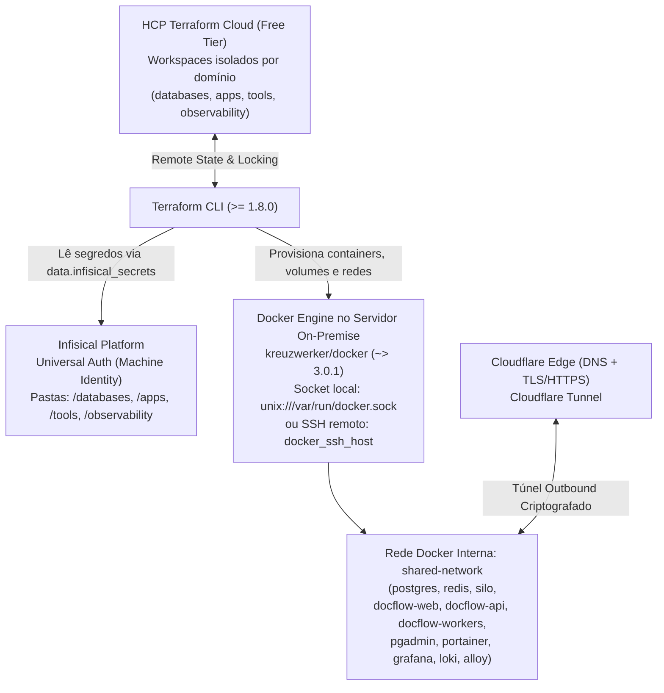

# DocFlow Infrastructure (IaC) — `infra/`

Diretório de **Infraestrutura como Código (IaC)** do **DocFlow**. Gerencia de forma declarativa, modular e automatizada os bancos de dados, aplicações próprias, ferramentas operacionais e observabilidade no servidor **on-premise**, com exposição externa via **Cloudflare Tunnel**.

> **Documentação Técnica do Módulo (`infra/docs/`):**
> - [`docs/servidor.md`](./docs/servidor.md) — Especificações de hardware, SO, rede (Tailscale) e dimensionamento do servidor on-premise (`INF-05`).
> - [`docs/catalogo-modulos.md`](./docs/catalogo-modulos.md) — Catálogo dos 4 domínios (`databases`, `apps`, `tools`, `observability`), mapeamento dos 2 `Dockerfile`s para os submódulos de `apps`, rede `shared-network` e **Cloudflare Tunnel** (DNS + TLS).
> - [`docs/variaveis-e-segredos.md`](./docs/variaveis-e-segredos.md) — Estrutura de pastas no **Infisical** (`/databases`, `/apps`, `/tools`, `/observability`), inventário de variáveis e contratos de `variables.tf`.
> - [`AGENTS.md`](./AGENTS.md) — Guia de regras estritas e passo a passo para criação/manutenção de módulos Terraform.

---

## 1. Visão Geral e Decisões Arquiteturais (DOC-07)

A infraestrutura do DocFlow opera em **servidor próprio (on-premise)** e fundamenta-se nos seguintes pilares:

1. **Servidor On-Premise + Exposição Segura via Cloudflare Tunnel**:
   - A hospedagem física reside em servidor próprio on-premise (sem custo de instâncias em nuvem para compute/storage).
   - **DNS e TLS providos pelo Cloudflare**: em vez de abrir portas `80`/`443` no roteador local ou gerenciar certificados Let's Encrypt manualmente, o túnel da Cloudflare publica `app.<dominio>`, `api.<dominio>` e `s3.<dominio>` com HTTPS/TLS e proteção DDoS/WAF nativos.
   - **Consequências operacionais do on-premise**: exige atenção a nobreak/UPS, reinício automático de containers (`restart = "always"` / `must_run = true`), monitoramento de disco/recursos e rotina de backup externo (*off-site*) do PostgreSQL.
2. **Ciclo de Vida 100% Declarativo via Terraform + Docker Socket**:
   - Todo o ciclo de vida dos recursos Docker (contêineres, redes, volumes, imagens e arquivos de configuração) é controlado pelo **Terraform (`>= 1.8.0`)** através do provider `kreuzwerker/docker` (`~> 3.0.1`).
   - No servidor (ou runner self-hosted), o Terraform atua diretamente sobre o **socket Unix do Docker (`unix:///var/run/docker.sock`)**; na máquina do desenvolvedor, conecta-se via túnel SSH seguro (`docker_ssh_host` lido do Infisical).
3. **Estado Remoto no HCP Terraform Cloud (Tier Gratuito)**:
   - O estado (`.tfstate`) é armazenado e protegido com *state locking* no **HCP Terraform Cloud** (plano gratuito), isolado em **workspaces por domínio** (`databases`, `apps`, `tools`, `observability`).
   - Nenhum arquivo `.tfstate` é mantido ou versionado localmente.
4. **Política de Segredo Zero (*Zero-Secret Policy*) com Infisical**:
   - Nenhuma senha, token, chave de API ou string de conexão sensível fica no Git ou em `.tfvars` versionados.
   - Todos os segredos são lidos dinamicamente pelo provider `infisical/infisical` (`~> 0.16.0`) via **Universal Auth** (Machine Identity).
5. **Topologia de Rede Interna (`shared-network`)**:
   - Os contêineres comunicam-se internamente pela rede bridge `shared-network` (criada pelo domínio `databases`) usando o DNS interno do Docker (nome do container como hostname), sem expor portas sensíveis para fora do host.

---

## 2. Arquitetura de Integração dos Provedores



### 2.1. Declaração Canônica de Providers e Backend (`provider.tf`)

Nos Root Modules (`<dominio>/provider.tf`), utiliza-se o bloco `cloud` do HCP Terraform aliado aos providers `kreuzwerker/docker` e `infisical/infisical`:

```hcl
terraform {
  required_version = ">= 1.8.0"

  cloud {
    organization = "DocFlow"

    workspaces {
      name = "<nome-do-dominio>" # "databases", "apps", "tools" ou "observability"
    }
  }

  required_providers {
    docker = {
      source  = "kreuzwerker/docker"
      version = "~> 3.0.1"
    }
    infisical = {
      source  = "infisical/infisical"
      version = "~> 0.16.0"
    }
  }
}

provider "docker" {
  host = var.docker_host != "" ? var.docker_host : data.infisical_secrets.databases_secrets.secrets["docker_ssh_host"].value

  registry_auth {
    address  = "ghcr.io"
    username = data.infisical_secrets.databases_secrets.secrets["ghcr_username"].value
    password = data.infisical_secrets.databases_secrets.secrets["ghcr_token"].value # gitleaks:allow
  }
}

provider "infisical" {
  host          = "https://app.infisical.com"
  client_id     = var.infisical_client_id
  client_secret = var.infisical_client_secret
}
```

### 2.2. Estratégia Híbrida de Conexão com o Docker (`docker_host`)

| Cenário de Execução | Onde o Terraform Roda | Valor de `var.docker_host` | Como Conecta ao Servidor | Racional |
| :--- | :--- | :--- | :--- | :--- |
| **No Servidor / Runner Self-Hosted (CI/CD)** | Dentro do próprio servidor on-premise | `unix:///var/run/docker.sock` (via `TF_VAR_docker_host`) | **Socket Unix Local** (`/var/run/docker.sock`) | Usa o próprio socket do Docker do servidor, sem overhead de rede ou chaves SSH. |
| **Máquina do Desenvolvedor** | Workstation local | `""` *(vazio, valor padrão)* | **Túnel SSH** (`docker_ssh_host` vindo do Infisical, ex.: via VPN/Tailscale) | Permite rodar `terraform plan`/`apply` remotamente com segurança usando a chave SSH do operador. |

---

## 3. Estrutura de Diretórios e Modularização em 3 Camadas

A infraestrutura em `infra/` é dividida em **4 domínios** (`databases`, `apps`, `tools`, `observability`), seguindo o padrão em **3 camadas** (`Root Module` → `Orquestrador env_base` → `Módulo Atômico de Serviço`):

```text
infra/
├── databases/                      # 1. Domínio de Bancos de Dados e Storage (Sobe primeiro)
│   ├── modules/
│   │   ├── postgres/               # PostgreSQL 16 Alpine
│   │   ├── redis/                  # Redis com limites de CPU/RAM e AOF
│   │   ├── silo/                   # Silo (fork do MinIO S3-compatível) + setup de buckets/usuários
│   │   └── env_base/               # Orquestrador de databases + criação da shared-network
│   ├── main.tf                     # Root Module: lê Infisical (/databases e /observability) e instancia env_base
│   ├── provider.tf                 # Backend HCP Terraform (workspace: databases) + providers docker/infisical
│   ├── variables.tf                # Contrato de variáveis (Infisical Auth + docker_host)
│   ├── output.tf                   # Outputs do domínio
│   └── terraform.tfvars.example    # Exemplo de preenchimento das credenciais do Infisical
├── apps/                           # 2. Domínio das Aplicações desenvolvidas por nós (2 Dockerfiles = 2 submódulos)
│   ├── modules/
│   │   ├── web/                    # Frontend React + Nginx (imagem gerada por apps/web/Dockerfile)
│   │   ├── server/                 # Backend FastAPI + Workers Celery (imagem única de apps/server/Dockerfile)
│   │   └── env_base/               # Orquestrador das aplicações DocFlow
│   ├── main.tf                     # Root Module: lê Infisical (/apps e /databases) e instancia env_base
│   ├── provider.tf                 # Backend HCP Terraform (workspace: apps) + providers docker/infisical
│   ├── variables.tf
│   ├── output.tf
│   └── terraform.tfvars.example
├── tools/                          # 3. Domínio de Ferramentas Operacionais e Apoio
│   ├── modules/
│   │   ├── pgadmin/                # Gestão web do PostgreSQL
│   │   ├── portainer/              # Gestão visual dos contêineres Docker
│   │   └── env_base/               # Orquestrador de ferramentas
│   ├── main.tf                     # Root Module: lê Infisical (/tools e /databases) e instancia env_base
│   ├── provider.tf                 # Backend HCP Terraform (workspace: tools) + providers docker/infisical
│   ├── variables.tf
│   ├── output.tf
│   └── terraform.tfvars.example
├── observability/                  # 4. Domínio de Telemetria, Logs e Métricas
│   ├── modules/
│   │   ├── grafana/                # Dashboards e alertas
│   │   ├── grafana_loki/           # Agregador de logs com backend S3 (Silo)
│   │   ├── grafana_alloy/          # Coletor de logs/métricas dos containers
│   │   └── env_base/               # Orquestrador de observabilidade
│   ├── main.tf                     # Root Module: lê Infisical (/observability e /databases) e instancia env_base
│   ├── provider.tf                 # Backend HCP Terraform (workspace: observability) + providers docker/infisical
│   ├── variables.tf
│   ├── output.tf
│   └── terraform.tfvars.example
├── .gitleaksignore                 # Fingerprints de falsos positivos de segredos
├── .tflint.hcl                     # Configuração de regras de lint do Terraform
├── Makefile                        # Automação de qualidade e segurança (make check)
├── README.md                       # Este documento
├── AGENTS.md                       # Diretrizes para agentes de IA e contribuidores
└── docs/                           # Documentação técnica da infraestrutura
    ├── catalogo-modulos.md         # Detalhamento dos 4 domínios, 2 Dockerfiles e Cloudflare Tunnel
    └── variaveis-e-segredos.md     # Inventário de pastas (/databases, /apps, /tools, /observability) no Infisical
```

### Papel de Cada Camada

```text
┌─────────────────────────────────────────────────────────┐
│     1. Root Module (<dominio>/)                         │
│   - Autentica no Infisical e lê segredos da pasta       │
│   - Configura o provider docker (socket ou SSH)         │
│   - Configura o backend HCP Terraform via bloco cloud   │
└────────────────────────────┬────────────────────────────┘
                             │ Injeta parâmetros e credenciais
                             ▼
┌─────────────────────────────────────────────────────────┐
│     2. Orquestrador de Domínio (modules/env_base)       │
│   - Cria (em databases) ou consome a shared-network     │
│   - Instancia e conecta os submódulos de serviço        │
└──────────────┬───────────────────────────┬──────────────┘
               │ Instancia                 │ Instancia
               ▼                           ▼
┌─────────────────────────────┐ ┌─────────────────────────────┐
│  3. Módulo Atômico A        │ │  3. Módulo Atômico B        │
│  (ex: modules/postgres)     │ │  (ex: modules/silo)         │
│  - docker_image             │ │  - docker_image             │
│  - docker_volume            │ │  - docker_volume            │
│  - docker_container         │ │  - docker_container         │
└─────────────────────────────┘ └─────────────────────────────┘
```

---

## 4. Padrões Obrigatórios de Implementação Docker (HCL)

1. **Ciclo de Vida (`lifecycle`) em todo `docker_container`**:
   Evita recriações acidentais de containers causadas por metadados internos do Docker Engine:
   ```hcl
   lifecycle {
     ignore_changes = [
       network_mode,
       entrypoint,
       volumes,
       env
     ]
   }
   ```
2. **Imagens com Versão Fixa e `keep_locally = true`**:
   ```hcl
   resource "docker_image" "service_img" {
     name         = "postgres:16.2-alpine"
     keep_locally = true
   }
   ```
3. **Persistência via `docker_volume` Nomeado**:
   Dados de estado (PostgreSQL, Redis, Silo, Loki, Grafana) devem usar `docker_volume` gerenciado pelo Terraform (ex.: `postgres-data`, `silo-data`).
4. **Injeção de Configurações via `upload` + `templatefile`**:
   Arquivos YAML/JSON/INI (como `loki-config.yaml`, `datasources.yaml` do Grafana ou configurações do `alloy`) ficam na pasta `files/` do módulo atômico e são injetados no container via bloco `upload`.

---

## 5. Governança, Qualidade e DevSecOps (`make check`)

Antes de abrir qualquer Pull Request alterando `infra/`, execute a bateria de verificações estáticas e de segurança:

```bash
cd infra
make check
```

| Alvo do Makefile | Ferramenta | O que valida |
| :--- | :--- | :--- |
| `make fmt` | `terraform fmt -check -recursive` | Padronização e formatação canônica dos arquivos `.tf`. |
| `make gitleaks` | `zricethezav/gitleaks` | Varredura de segredos no histórico Git (respeita `.gitleaksignore`). |
| `make trufflehog` | `trufflesecurity/trufflehog` | Detecção de chaves e credenciais de alta entropia no sistema de arquivos. |
| `make tflint` | `ghcr.io/terraform-linters/tflint` | Linting estático e boas práticas de HCL conforme `.tflint.hcl`. |
| `make trivy` | `aquasec/trivy` | Auditoria de misconfigurations e vulnerabilidades (`CRITICAL,HIGH`). |
| `make checkov` | `bridgecrew/checkov` | Conformidade de políticas de segurança IaC e segredos. |

---

## 6. Guia Rápido de Execução

### 1. Autenticar no HCP Terraform Cloud
```bash
terraform login
# ou via variável de ambiente em pipelines/servidor:
export TF_TOKEN_app_terraform_io="<seu_token_hcp_terraform>"
```

### 2. Configurar as Credenciais do Infisical no Domínio Desejado
```bash
cd infra/databases
cp terraform.tfvars.example terraform.tfvars
```
Preencha no `terraform.tfvars` (arquivo ignorado pelo `.gitignore`) apenas as 3 variáveis da Machine Identity do Infisical:
```hcl
infisical_client_id     = "<client_id>"
infisical_client_secret = "<client_secret>"
infisical_workspace_id  = "<workspace_id>"
```

### 3. Definir o Socket do Docker (Quando Executado Diretamente no Servidor)
Se você estiver rodando o comando dentro do próprio servidor on-premise (ou no runner self-hosted):
```bash
export TF_VAR_docker_host="unix:///var/run/docker.sock"
```
*(Se estiver rodando da sua máquina local, deixe `TF_VAR_docker_host` vazio para que o Terraform use o `docker_ssh_host` configurado no Infisical).*

### 4. Inicializar, Planejar e Aplicar
```bash
terraform init
terraform plan
terraform apply
```
