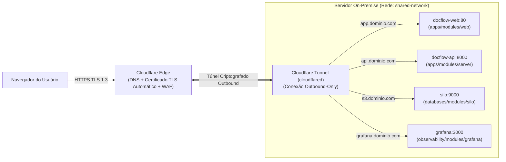

# Catálogo de Domínios, Submódulos, Dockerfiles e Cloudflare Tunnel

Este documento detalha os **4 domínios** da infraestrutura do **DocFlow** em `infra/` (`databases`, `apps`, `tools`, `observability`), como os **2 `Dockerfile`s** do projeto mapeiam para os submódulos de `apps`, a topologia da rede `shared-network` e a exposição via **Cloudflare Tunnel**.

---

## 1. Relação entre os `Dockerfile`s do Projeto e o Domínio `apps`

Em todo o monorepo do DocFlow, existem **apenas 2 `Dockerfile`s** (um para cada aplicação que nós desenvolvemos):

| Dockerfile no Monorepo | Imagem Gerada (GHCR) | Submódulo Terraform Correspondente | Contêineres Provisionados pelo Submódulo |
| :--- | :--- | :--- | :--- |
| [`apps/web/Dockerfile`](../../apps/web/Dockerfile) | `ghcr.io/<org>/docflow-web:<tag>` | `infra/apps/modules/web` | **`docflow-web`**: Frontend React compilado servido via Nginx (porta `80`). |
| `apps/server/Dockerfile` | `ghcr.io/<org>/docflow-server:<tag>` | `infra/apps/modules/server` | Usa **1 único `docker_image`** (`docflow-server`) e sobe os contêineres mudando apenas o `command`:<br>1. **`docflow-api`** (`uvicorn app.main:app --host 0.0.0.0 --port 8000`)<br>2. **`docflow-worker-io`** (`celery -A app.worker worker -Q io`)<br>3. **`docflow-worker-cpu`** (`celery -A app.worker worker -Q cpu` — com limites dedicados de CPU/RAM para FFmpeg/LibreOffice)<br>4. **`docflow-worker-ai`** (`celery -A app.worker worker -Q ai` — chamadas Deepgram e Gemini) |

> **Por que isso é ótimo?**
> Evitamos duplicar `Dockerfile`s e evitamos criar 4 submódulos quase idênticos para o backend. O submódulo `infra/apps/modules/server` baixa a imagem `docflow-server` uma única vez (`keep_locally = true`) e instancia a API e os workers compartilhando as mesmas variáveis de banco, Redis e Silo.

---

## 2. Catálogo Completo dos 4 Domínios e Submódulos

Cada um dos 4 domínios possui seu próprio workspace no **HCP Terraform Cloud** e sua própria pasta no **Infisical**:

| Domínio | Submódulo (`modules/<servico>`) | Descrição Técnica | Rede Docker | Hostname Interno (DNS Docker) |
| :--- | :--- | :--- | :--- | :--- |
| **`databases`** | `postgres` | Banco relacional principal (PostgreSQL 16.2 Alpine) com logs de conexão e *slow queries* habilitados. | `shared-network` | `postgres:5432` |
| **`databases`** | `redis` | Broker do Celery, cache e controle de *rate limit* com quotas de CPU/RAM e persistência. | `shared-network` | `shared-redis:6379` |
| **`databases`** | `silo` | Object Storage S3-compatível on-premise (Silo, fork do MinIO) + container de setup de buckets (`media-raw`, `media-processed`, `documents`, `observability`) e usuários. | `shared-network` | `silo:9000` (API S3)<br>`silo:9001` (Console) |
| **`apps`** | `web` | Frontend SPA em React + Nginx (`apps/web/Dockerfile`). | `shared-network` | `docflow-web:80` |
| **`apps`** | `server` | Monolito modular Python (`apps/server/Dockerfile`): sobe o container `docflow-api` (FastAPI) e os containers `docflow-worker-io`, `docflow-worker-cpu` e `docflow-worker-ai` (Celery). | `shared-network` | `docflow-api:8000`<br>`docflow-worker-io`<br>`docflow-worker-cpu`<br>`docflow-worker-ai` |
| **`tools`** | `pgadmin` | Interface web administrativa para inspeção e manutenção do PostgreSQL. | `shared-network` | `pgadmin:80` |
| **`tools`** | `portainer` | Gerenciamento visual dos contêineres, volumes e imagens do servidor Docker. | `shared-network` | `portainer:9443` |
| **`observability`** | `grafana` | Painel unificado de observabilidade com *datasources* e dashboards provisionados via `upload`. | `shared-network` | `grafana:3000` |
| **`observability`** | `grafana_loki` | Agregador de logs estruturados persistindo chunks no bucket de observabilidade do Silo (S3). | `shared-network` | `grafana-loki:3100` |
| **`observability`** | `grafana_alloy` | Agente coletor de logs e métricas dos contêineres Docker. | `shared-network` | `grafana-alloy` |

---

## 3. Exposição Segura à Internet via Cloudflare Tunnel (DNS + TLS)

O servidor on-premise do DocFlow utiliza **Cloudflare Tunnel (`cloudflared`)** para expor os serviços necessários à internet. Assim, **DNS e certificados TLS/HTTPS são 100% providos pela Cloudflare**, sem necessidade de abrir portas `80`/`443` no roteador ou manter proxy Let's Encrypt local:



### Principais Vantagens dessa Topologia:
1. **DNS e TLS Gerenciados pela Cloudflare**: os subdomínios (`app.`, `api.`, `s3.`) são roteados automaticamente pelo túnel com HTTPS ativo de fábrica.
2. **Upload Multipart Direto para o Silo (`s3.<dominio>`)**: o navegador faz upload multipart de vídeos de até 10 GB direto para o endpoint HTTPS `s3.<dominio>` (que aponta pelo túnel para `silo:9000`), usando URLs pré-assinadas emitidas pela `docflow-api`.

---

## 4. Topologia da Rede `shared-network` e Ordem de Subida

1. **Criação Única no Domínio `databases`**:
   Como os bancos de dados são a base de tudo, a rede global `shared-network` é criada em `infra/databases/modules/env_base/main.tf`:
   ```hcl
   resource "docker_network" "shared" {
     name   = "shared-network"
     driver = "bridge"
   }
   ```
2. **Consumo via `data` nos Demais Domínios (`apps`, `tools`, `observability`)**:
   Nos módulos `env_base` de `apps`, `tools` e `observability`, a rede é referenciada via *data source*:
   ```hcl
   data "docker_network" "shared" {
     name = "shared-network"
   }
   ```
3. **Ordem de Provisionamento**:
   1º **`databases`** (cria a `shared-network` e sobe `postgres`, `redis` e `silo`) → 2º **`apps`**, **`tools`** e **`observability`** (em qualquer ordem).
